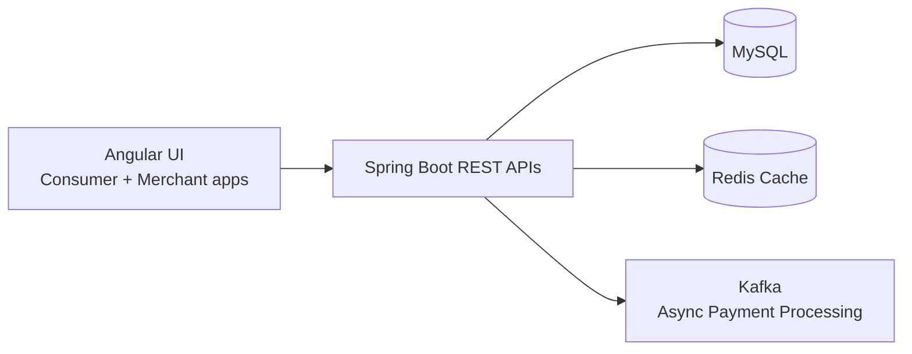

# Cognizant: Fintech Payments & Wallet Platform (Case Study)

> **Role:** Software Engineer · **Period:** Jan 2021 – Aug 2022 · **Location:** India
> **Note:** This is a high-level, sanitized case study. It contains no proprietary code or client data.

## Overview

I built backend services and UI features for core fintech platforms covering wallet, payments, and merchant transactions, serving millions of daily users with high concurrency during peak hours.

## Impact at a Glance

| Area | Result |
| --- | --- |
| Transaction latency | **20% lower** (SQL query and indexing optimization) |
| API response time | **18% faster** (Redis caching for hot data) |
| Scale | Millions of daily users; peak loads such as bill payments and recharges |
| Architecture | Legacy modules migrated toward **independently scalable microservices** |
| Delivery | Jenkins + Git automation reduced manual deployment effort |

## High-Level Architecture (simplified)

## What I Built

### 1. Payment and wallet services
- Developed Java / Spring Boot / MySQL backend services for wallet, payments, and merchant transactions.
- Built RESTful APIs enabling secure, reliable communication across distributed services under high concurrency.

### 2. Performance engineering
- Optimized SQL queries and indexing to cut transaction latency by 20%.
- Introduced Redis caching for frequently accessed data, improving API response time by 18%.

### 3. Event streaming
- Integrated Kafka for asynchronous payment processing and reliability across distributed systems.

### 4. Modernization
- Contributed to migrating legacy modules to microservices for better maintainability and independent scaling.

### 5. Frontend and quality
- Built features with JavaScript, HTML, CSS, and Angular for consumer- and merchant-facing apps.
- Worked with QA on unit and integration tests (JUnit) to improve quality and reduce defects.
- Automated builds and deployments with Jenkins and Git.

## Tech Stack

**Backend:** Java, Spring Boot, REST
**Frontend:** Angular, JavaScript, HTML, CSS
**Messaging:** Apache Kafka
**Data:** MySQL, Redis
**DevOps / Testing:** Jenkins, Git, JUnit

---
[← Back to profile](https://github.com/bindukalam)
